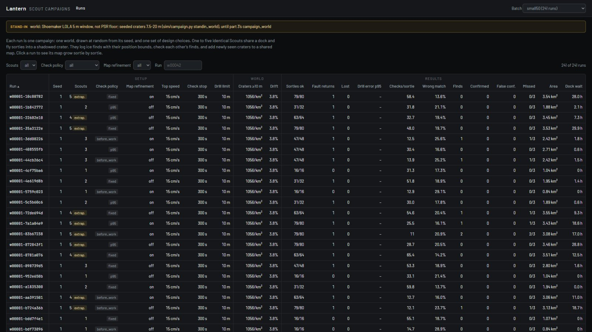
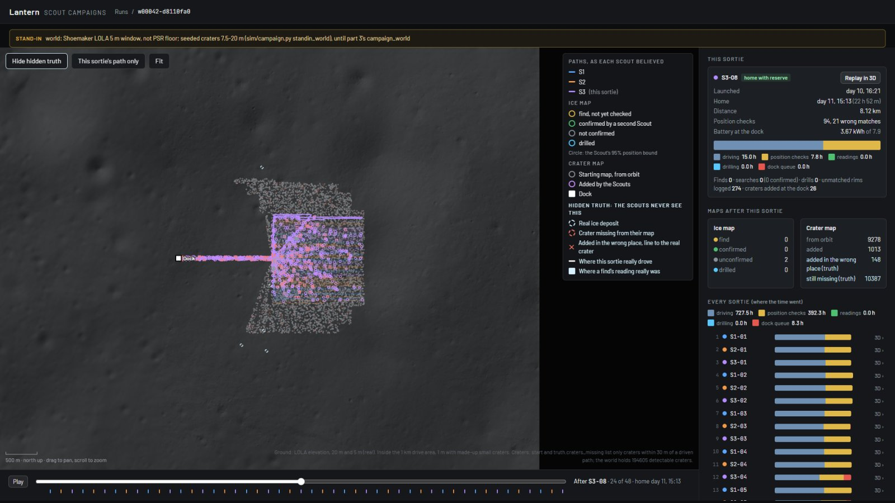
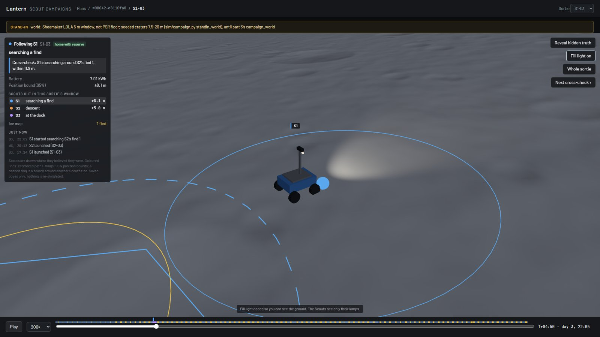

# Lantern

**A campaign simulator for the PROSPECT Scouts, for the RASC-AL 2027 paper.**

One dock in a permanently shadowed crater sends out one to five identical
Scouts. Each sortie drives a survey, stops to fix its position against crater
rims, logs ice readings, and comes home to charge. A second Scout checks
each ice find. Craters the Scouts see but the orbital map lacks are added to
a shared crater map, so later sorties navigate on a better map.

Lantern runs thousands of seeded worlds through that workflow and writes
the numbers for the paper's section 4.6 and Figure 1. A local site replays
any run.

## What a run is

A run is one world seed and one set of design choices: fleet size, when to
check position, whether to refine the map, top speed, drill limit. The world
is drawn from the seed alone, so every design choice is tried on the same
worlds. After each position fix, a Scout's error is drawn from ShadowNav's
simulated results, not computed by a filter (`sim/campaign.py`). Every constant lives in `sim/settings.py`
with its source, or marked `assumed`.

Each run writes `record.json` and `poses.npz` to
`data/campaigns/<batch_id>/<run_id>/`. The format is in
[docs/handoffs.md](docs/handoffs.md), "Campaign simulator". The scope is in
[docs/campaign-spec.md](docs/campaign-spec.md).

## Run it

    python -m sim.campaign --seed 42           # one run: 3 Scouts x 16 sorties
    python -m sim.batch --batch-id small50 --worlds 50 \
        --sweep n_scouts=1,2,3,4,5 --sweep check_policy=fixed,p95,before_work
    python app.py                              # the site, at http://localhost:8000

A batch writes `summary.csv`, `by_sortie.csv`, `drills.csv`, `report.md`
(hand checks and what is still a stand-in) and Figures 1a and 1b.

## The site

`python app.py` builds the terrain assets it needs and serves the runs from
the data folder. The site runs locally only.

- **Runs list.** Every run in a batch with its setup and results. Sort by any
  column, filter by fleet size, check policy and map refinement.
- **Run map.** The crater seen from above. A slider steps through the
  sorties: each Scout's believed path, the ice map with each find's 95%
  position bound, the craters added to the map, and a time bar for every
  sortie.
- **Hidden truth.** By default the map shows only what the Scouts knew. A
  labelled button reveals the truth: where they really drove, the real
  deposits, the craters missing from their map, and the ones added in the
  wrong place.
- **3D replay.** Any sortie from its saved poses, with every Scout that was
  out at the same time. "Next cross-check" jumps to the moment a second
  Scout searches around another's find.

## What is real and what is not

Real: the LOLA elevation of the Shoemaker crater region (5 m and 20 m).
Simulated: the crater population below orbital resolution, the ice
deposits, and every instrument reading. The current world is a 6 km window
of Shoemaker terrain, not shadowed floor. Every page says so in a banner
until the real world model lands.

Borrowed, as a modelling choice: ShadowNav's Table 2 (Cauligi et al., 2023,
in `docs/sources/`) gives the final position error over whole simulated
traverses, 25 seeds each. Lantern uses those errors as the error right after
each fix. That is the team's draft's choice, not something ShadowNav
measured.

The main caveat is the false-match rate, the share of fixes that match the
wrong crater. It is an assumed model, and it decides whether one Scout can
confirm another's find. Above about 11%, at the 6 m confirmation limit,
ShadowNav's accuracy is not enough for the check. Finding 1 in
`docs/paper-findings.md` (branch `campaign-handoffs`) has the numbers.

The 3D replay is for looking. It re-simulates nothing, and the paper's
numbers come from the batch files, not from the site.

## History

Lantern began at Monad Blitz Oregon on 15 November 2026 as a shared,
on-chain map of lunar ice. That README, with its link to the hackathon
build, is in [_archive/docs/hackathon-README.md](_archive/docs/hackathon-README.md). The chain
code is in `_archive/`.
