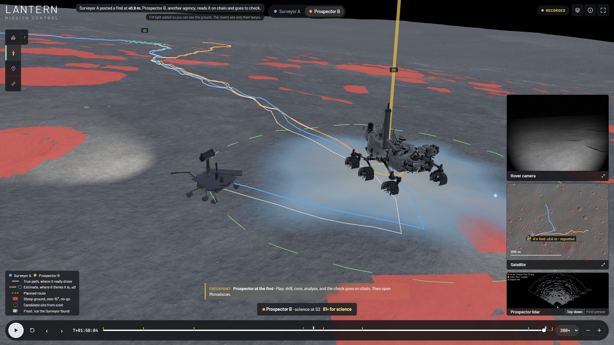
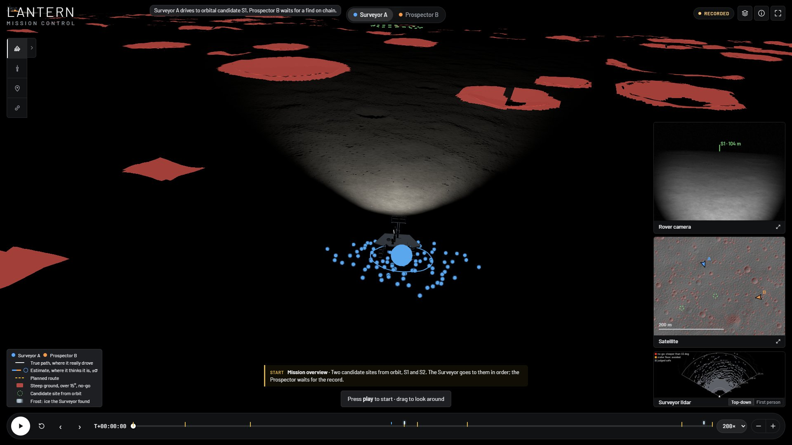
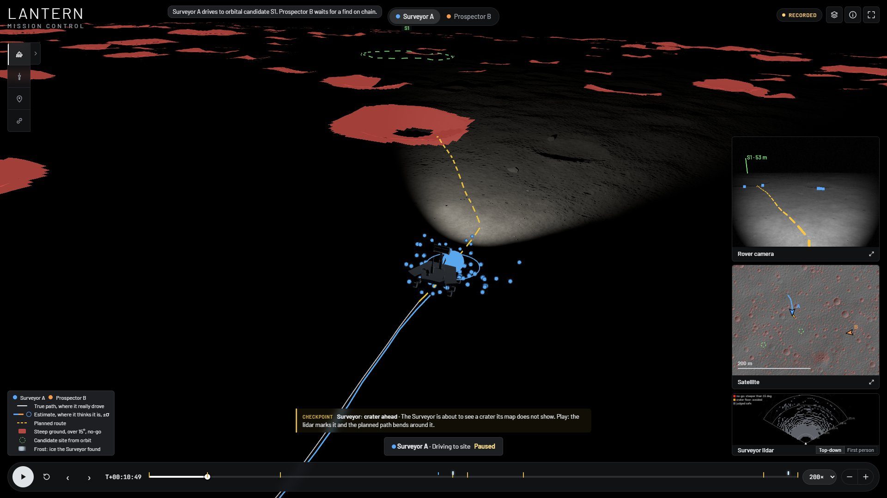
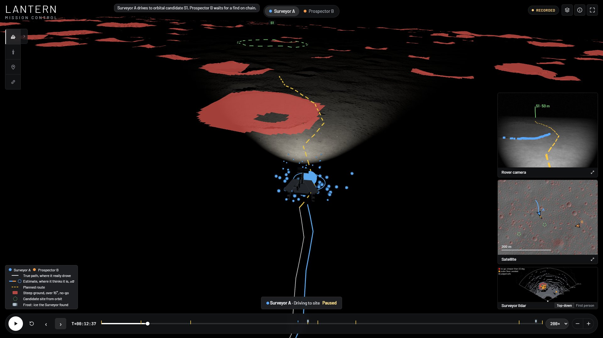
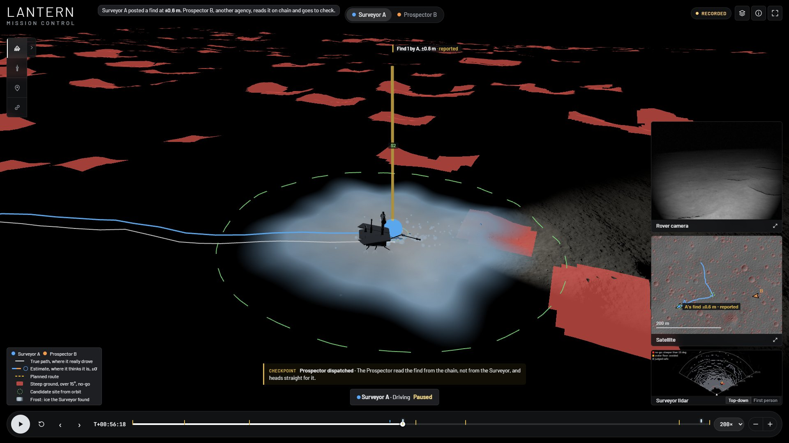
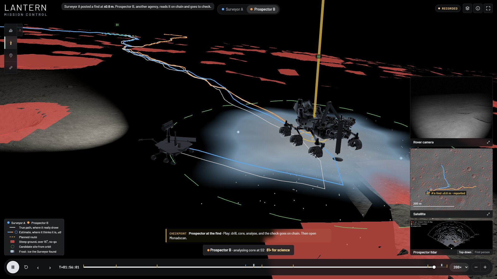
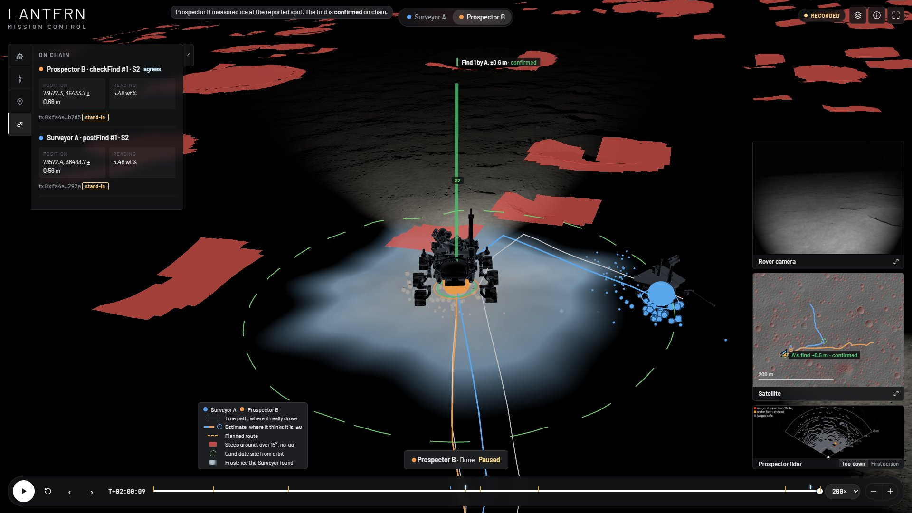
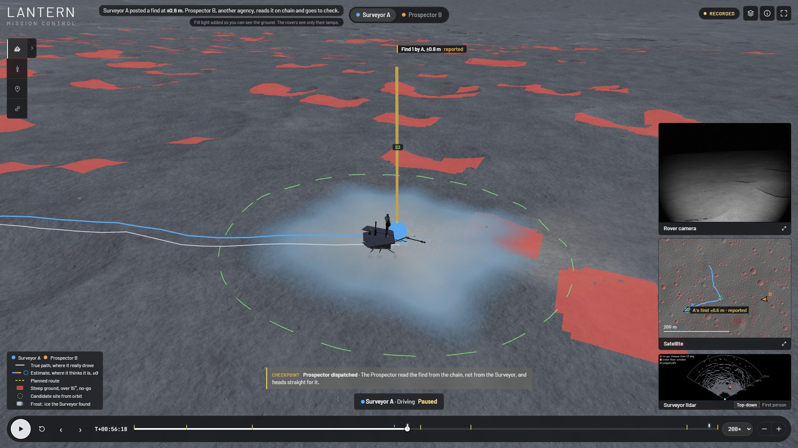

# Lantern

**A shared map of lunar ice that rovers write themselves, and check for each other.**

**See it live: https://lantern-teal.vercel.app**

## The problem

Water ice at the Moon's south pole is the resource every lunar plan depends
on. NASA's LCROSS impact measured water in a crater there. But that ice sits
in craters that never see sunlight. Rover missions need to know their
position to within 10 m of the orbital map. A rover tracking itself by its
own wheels and cameras drifts about 2%, so after 500 m it can be off by more
than that (JPL, ShadowNav, 2023).

Rovers will also come from different agencies and companies. The Artemis
Accords ask nations to share science data, but they do not require anyone to
report a find. Lantern gives agencies a voluntary way to report finds and to
check each other's.

## What Lantern does

- **Rovers find their way in the dark.** A lamp under the camera makes each
  crater rim throw a shadow line. Matching those rims to the orbital map
  fixes the rover's position, the method from JPL's ShadowNav.
- **A Surveyor posts what it finds.** When it measures ice, it sends the find
  to a contract on Monad, together with how sure it is of its position.
- **A Prospector from another agency checks it.** It reads the find from the
  chain, drives there on its own navigation and measures again. The contract
  accepts a check only from a different agency, and only from close enough.
- **The record is public and tamper-evident.** Every find and every check is
  a transaction. Agreements and disagreements both stay on the record.

## The mission

Mission Control replays one complete mission, with two rovers and two candidate
sites picked from orbit. The replay pauses at each key moment, and you press
Play to go on.

**1. Two candidate sites from orbit.** The Surveyor (blue) sets out for S1.
The Prospector (orange) waits for a find to appear on chain.

**2. A crater the map missed.** The orbital map is too coarse to show small
craters. The planned route (amber) runs straight at one. Red marks ground
too steep to drive.

**3. Around it.** The rover's lidar sees the crater, and the route bends
around it.

**4. A find, posted on chain.** S1 is dry. At S2 the Surveyor measures ice and
posts the find with its position, ±0.6 m. The Prospector reads it from the
chain, not from the Surveyor, and sets off.

**5. The check.** The Prospector drives to the find, drills, cores and
analyses. The Surveyor has parked a few metres aside.

**6. Confirmed.** The Prospector's reading agrees, so the find is confirmed.
Both transactions sit in the record.

## Fill light on and off

The rovers see only what their own lamps light. Mission Control can add a
fill light for viewers, so you can see the ground. Here is the same moment
both ways.

| What the rovers see: only their lamps | Fill light added for viewers |
|---|---|
|  |  |

## Built on

- **ShadowNav (NASA JPL):** finding a rover's position in the dark from
  lamp-lit crater rims (Cauligi et al., 2023; Atha et al., 2024).
- **NASA LOLA terrain:** laser elevation maps of the lunar south pole, near
  Shoemaker crater, from the Lunar Reconnaissance Orbiter.
- **NASA 3D rover models:** Opportunity and Perseverance, Mars rovers standing
  in for lunar ones.
- **Monad:** the Lantern contract is deployed on Monad testnet and its source
  is verified, with 25 tests on its checking rules.

Every source, and what each one contributed, is listed in
[docs/SOURCES.md](docs/SOURCES.md).

**Simulated:** the ice deposits and every instrument reading are simulated,
not NASA data. The screenshots show a recorded replay, whose transactions are
marked "stand-in" in the record.

## Team

Calvin, Joseph, Kellen and Ritvik, at Monad Blitz Oregon, 15 November 2026.

How to run it, the code layout and the tests are in [docs/TECHNICAL.md](docs/TECHNICAL.md).
